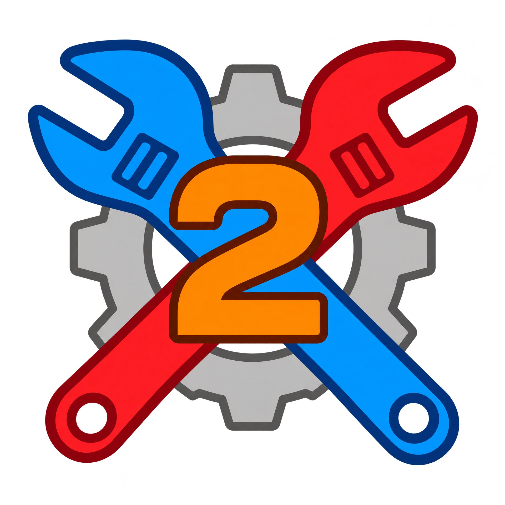

# Switch Toolbox 2

**A community-maintained toolkit for inspecting and editing Nintendo game assets.**

[Repository](https://github.com/realTimexo/Switch-Toolbox-2) · [Releases](https://github.com/realTimexo/Switch-Toolbox-2/releases) · [Report a bug](https://github.com/realTimexo/Switch-Toolbox-2/issues)

Maintained by **Timexo**. Built on the original [Switch Toolbox](https://github.com/KillzXGaming/Switch-Toolbox) by KillzXGaming and contributors.

## About

Switch Toolbox 2 continues the open-source Switch Toolbox project. It brings together viewers and editors for a wide range of Nintendo Switch, Nintendo 3DS, and Wii U formats. Format support varies; files from newer games and newer console generations may require additional work and should be tested individually.

The application is an experimental Windows desktop tool. Keep a backup of game files before editing them. It does not include or provide game keys, game content, or decryption material.

## Audio

The application can preview supported audio formats and export audio as WAV. **BWAV** support includes playback and importing a PCM WAV from the audio editor's right-click menu, then saving the edited audio back as BWAV. BWAV is Nintendo's AAL Binary Wave format and is distinct from NintendoWare BFWAV. Its documented structure is described by [Citric Composer](https://gota7.github.io/Citric-Composer/specs/binaryWav.html); BWAV encoding and decoding here use the project's existing VGAudio codec dependency.

## Download and build

Download a Windows ZIP from [Releases](https://github.com/realTimexo/Switch-Toolbox-2/releases), extract the full archive, and start `Toolbox.exe`. The desktop application targets .NET Framework 4.8 and Windows; install the .NET Framework 4.8 runtime if Windows prompts for it.

To build from source, open `Toolbox.sln` in Visual Studio with the .NET Framework 4.8 targeting pack and NuGet components installed, restore packages, and build the `Release` configuration. The repository's **Actions → Manual Windows Release** workflow can also be started manually. Enter a version name and release notes; it builds Windows binaries and publishes `SwitchToolbox2-<version>.zip` as a GitHub Release asset.

## Credits and license

This project is based on [KillzXGaming/Switch-Toolbox](https://github.com/KillzXGaming/Switch-Toolbox). The original project, its contributors, and the third-party libraries it uses remain credited; their notices and licenses are retained in the repository. Audio conversion relies on [VGAudio](https://github.com/Thealexbarney/VGAudio). The BWAV format reference is [Citric Composer by Gota7 and contributors](https://github.com/Gota7/Citric-Composer).

The repository is distributed under the **GNU General Public License v3.0**. See [`LICENSE`](LICENSE) and the individual notices under `Toolbox/Lib/Licenses` for the applicable terms. Nintendo and related product names are trademarks of their respective owners; this project is independent and is not affiliated with or endorsed by Nintendo.
